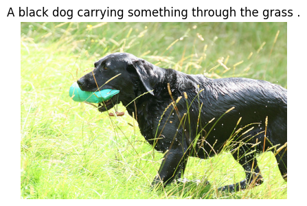
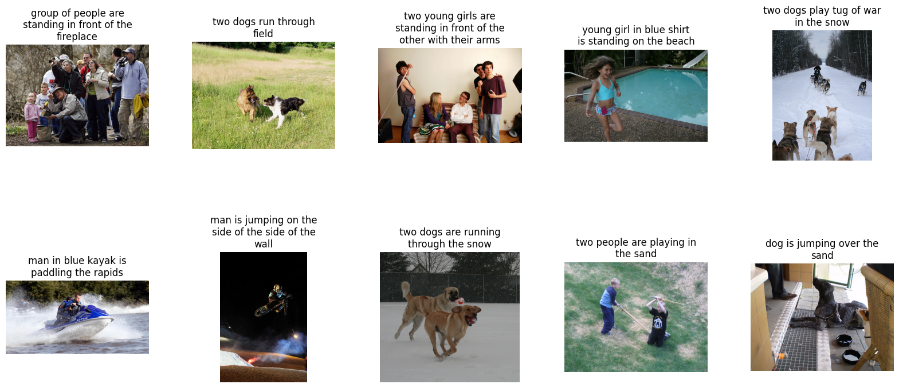
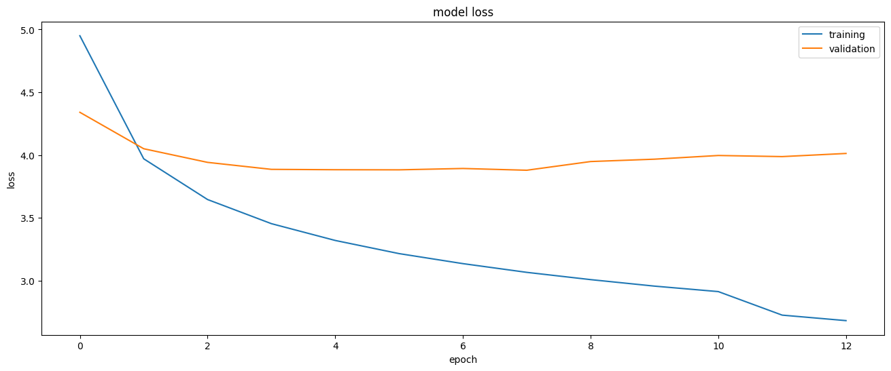

# Image Captioning with VGG16 and LSTM

An encoder–decoder model that looks at a photo and writes a sentence describing it.

> Lab 3 of *Advanced Deep Learning (D7047E)*, Luleå University of Technology, spring 2024. Group 7; see [Team](#team).



## How it works

```
image ─────────► VGG16 conv features (ImageNet, frozen) ──► dense ─┐
                                                                   ├─ concatenate ──► dense ──► next word
caption so far ──► word embeddings ──► LSTM(256) ──────────────────┘
```

This is the "merge" architecture: the image and the text are encoded separately and only combined at the end.

1. **Image encoder:** a pretrained VGG16 (without its classification head) turns each image into a feature vector. Features are extracted once and cached.
2. **Text preprocessing:** captions from the [Flickr8k](https://www.kaggle.com/datasets/adityajn105/flickr8k) dataset are lower-cased and cleaned, wrapped in `startseq`/`endseq` tokens, and tokenised.
3. **Caption encoder:** the partial caption goes through a word embedding and a 256-unit LSTM.
4. **Decoder:** image and caption vectors are concatenated and passed through dense layers that predict the next word over the vocabulary.
5. **Training:** a custom Keras data generator builds (image, partial caption → next word) pairs on the fly, so they never all sit in memory. Up to 25 epochs, with early stopping on validation loss (patience 5, best weights restored).
6. **Inference:** captions are generated greedily, one word at a time, until `endseq`.

## Results

Captions generated for unseen test images:



The model gets the main subject and action right in most cases ("two dogs run through field", "man in blue kayak is paddling the rapids"), and is weaker on counting and fine detail.



Validation loss levels off after a few epochs while training loss keeps falling, which is why early stopping kicks in. Natural next steps are more regularisation, beam search instead of greedy decoding, and an attention-based decoder that looks at different image regions for each word.

## Running it (VS Code / Python)

Download [Flickr8k](https://www.kaggle.com/datasets/adityajn105/flickr8k) into `./Flickr8k/` (an `Images/` folder plus `captions.txt`), or pass `--dataset path/to/Flickr8k`.

```bash
python -m venv .venv
source .venv/bin/activate        # Windows: .venv\Scripts\activate
pip install -r requirements.txt

python main.py extract-features          # VGG16 features for every image, cached in artifacts/features.npz
python main.py train                     # up to 25 epochs with early stopping; best model in artifacts/
python main.py caption --samples 10      # random validation images -> outputs/predicted_captions.png
python main.py caption --images photo.jpg
```

In VS Code, open the folder, select the `.venv` interpreter and use the **Run and Debug** panel (`.vscode/launch.json` has the three steps, plus "Caption an image file" for the image open in the editor). `pytest` runs fast smoke tests on synthetic data.

| Path | Contents |
|---|---|
| [`main.py`](main.py) | Command-line entry point |
| [`captioning/data.py`](captioning/data.py) | Caption cleaning, tokenizer, train/validation split by image |
| [`captioning/features.py`](captioning/features.py) | VGG16 feature extraction and caching |
| [`captioning/model.py`](captioning/model.py) | Merge model, training data generator, greedy decoding |
| [`captioning/train.py`](captioning/train.py) | Training with checkpoints/early stopping, loss plot, caption grids |

## Team

Group 7, D7047E Advanced Deep Learning: **Aamer Barood** and teammates. The original group repository, with full commit history, is [Gabmyr/D7047E-Labs-Group-7](https://github.com/Gabmyr/D7047E-Labs-Group-7).
